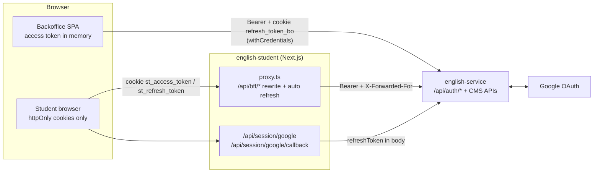
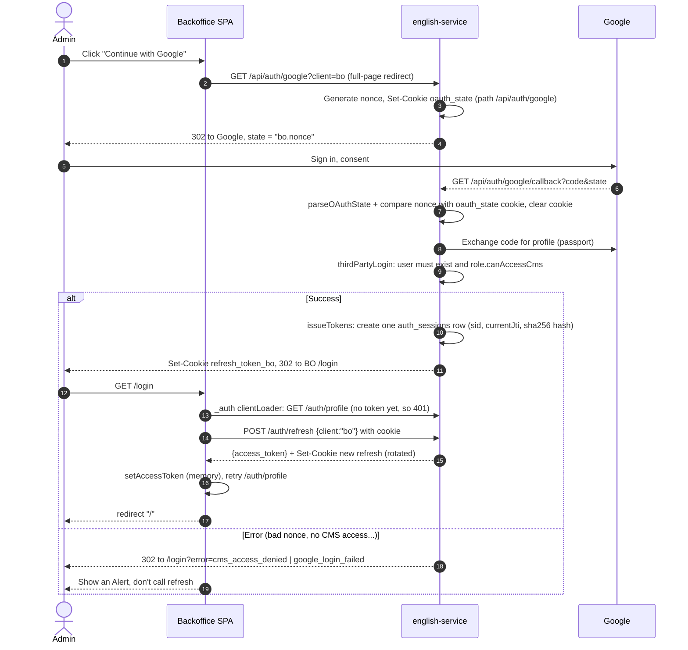
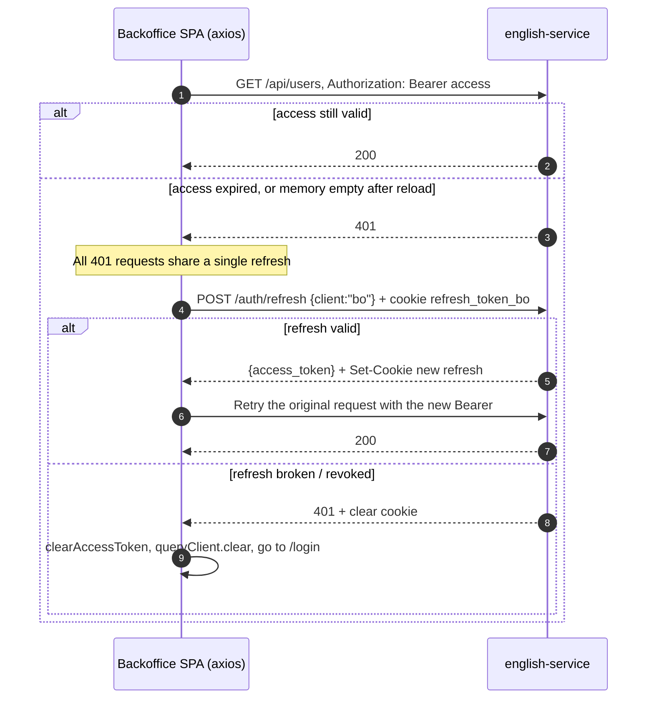
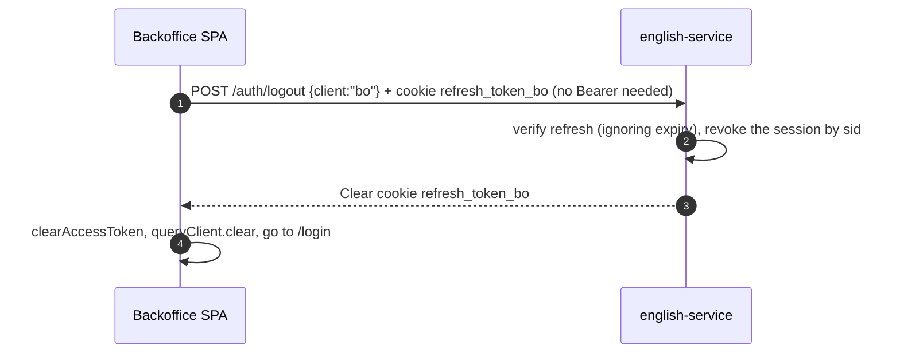
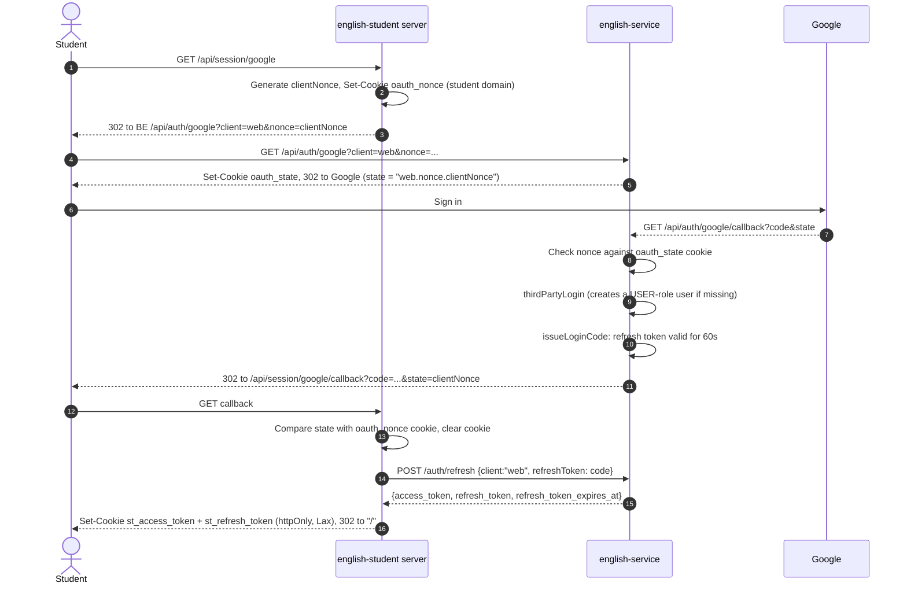
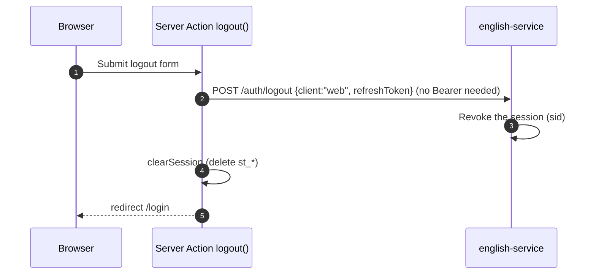
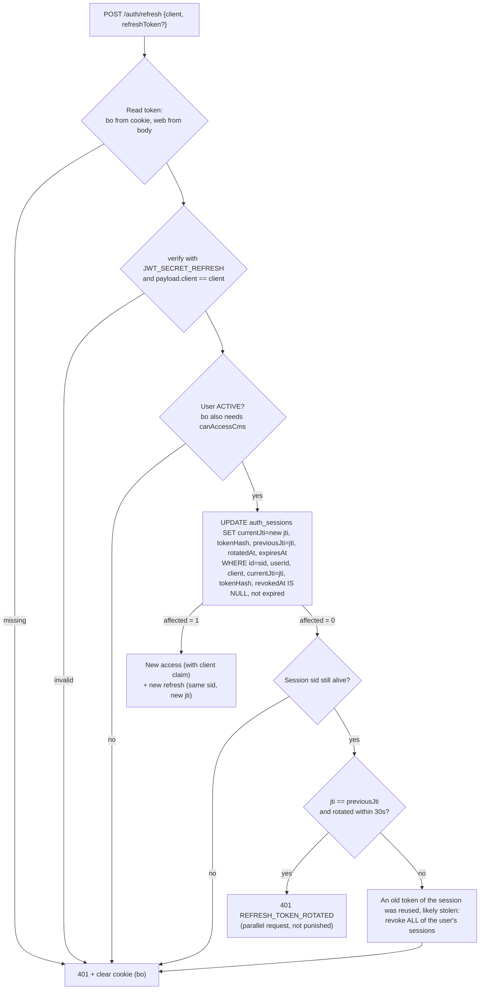

# Auth flow

This document describes authentication between **english-service** (BE), **english-backoffice** (BO, React SPA) and **english-student** (Next.js, whose server acts as a BFF).

|                     | Backoffice (`client = bo`)                                                                        | Student (`client = web`)                                                                      |
| ------------------- | ------------------------------------------------------------------------------------------------- | --------------------------------------------------------------------------------------------- |
| Access token        | Held in the SPA's **memory**, sent as `Authorization: Bearer`                                     | httpOnly cookie `st_access_token` on the student domain. The BFF attaches the Bearer header   |
| Refresh token       | httpOnly cookie `refresh_token_bo` set by the **BE** (path `/api/auth`, `SameSite=Lax`, `Secure`) | httpOnly cookie `st_refresh_token` on the student domain. The BFF sends it in the **body**    |
| Google login result | BE sets the refresh cookie and redirects to `/login`                                              | BE redirects with `?code=` (a single-use refresh token valid for 60s) and `state=clientNonce` |
| Login CSRF defence  | `oauth_state` cookie on the API domain                                                            | `oauth_state` (API) + `oauth_nonce` (student domain)                                          |
| CMS endpoints       | Allowed (`@Clients(AuthClient.BO)`)                                                               | 403                                                                                           |

## 1. Overview



The BE guard chain for every request: `ThrottleGuard` → `JwtAuthGuard` (skipped for `@Public`) → `PermissionGuard` (`@Clients` + `@CheckPermissions`, deny by default).

## 2. Backoffice

### 2.1 Google login



### 2.2 API calls, access token expiry, page reload



### 2.3 Logout



## 3. Student (Next.js BFF)

### 3.1 Google login



### 3.2 API calls through the BFF and automatic refresh

```mermaid
sequenceDiagram
  autonumber
  participant S as Browser
  participant P as proxy.ts (Next server)
  participant BE as english-service

  S->>P: Page request or /api/bff/* with st_* cookies
  alt Has st_access_token (cookie expires 30s before the JWT)
    P->>P: Use the current access token
  else Only st_refresh_token left
    P->>BE: POST /auth/refresh {client:"web", refreshToken} + X-Forwarded-For
    alt ok
      BE-->>P: New token pair (rotated)
      P->>P: Write new tokens into request and response cookies
    else REFRESH_TOKEN_ROTATED (a parallel request already rotated)
      P-->>S: Page: redirect to the same URL to pick up the new cookies
    else invalid
      P->>P: clearSession, treat as signed out
    end
  end
  alt /api/bff/*
    P->>BE: Rewrite to /api/*, drop the cookie header, attach Bearer + X-Forwarded-For
    BE-->>S: Response (on 401 the axios client goes to /login)
  else Page
    P-->>S: Signed out → /login; signed in and visiting /login → "/"
  end
```

### 3.3 Logout



## 4. Refresh token rotation (`POST /auth/refresh`)


